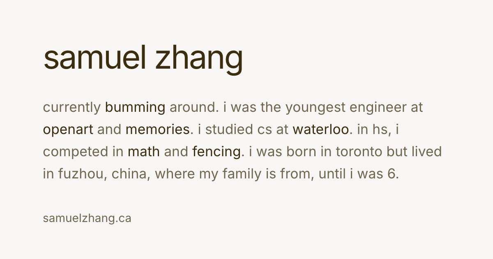

# samuelzhang.ca

The source for [samuelzhang.ca](https://samuelzhang.ca): a single page with a short bio, a few projects, and contact links. It's built with Next.js and Tailwind and edited through one config file.

- **One source of truth.** The bio, projects, and socials live in [`src/config.tsx`](src/config.tsx). The page, the meta description, and [`/llms.txt`](https://samuelzhang.ca/llms.txt) are all generated from it, so they never disagree.
- **Readable by agents.** [`/llms.txt`](src/app/llms.txt/route.ts) serves the whole site as plain markdown, prerendered at build time.
- **Light and dark.** It follows the system theme, has a manual toggle, and keeps the browser bar color in sync with whichever theme is showing.
- **Quiet motion.** Content fades in once after hydration. With reduced motion or no JavaScript, it's simply visible.



---

## Run it locally

You'll need Node.js 18.17 or later (required by Next.js 14).

```bash
git clone https://github.com/SamuelZ12/samuelzhang.ca.git
cd samuelzhang.ca
npm install
npm run dev
```

Then open <http://localhost:3000>.

## Edit the content

Almost every change happens in [`src/config.tsx`](src/config.tsx):

```tsx
projects: [
    {
        name: 'longcut',
        description: 'turns youtube videos into highlight reels, cited answers, and notes',
        url: 'https://www.longcut.ai',            // optional: live site
        github: 'https://github.com/SamuelZ12/longcut', // optional: repo
    },
],
```

- **`BIO`** is the bio, written as strings and `{ text, href }` links.
- **`projects`** fill the project list. A row links to `url` if there is one, otherwise to `github`.
- **`socials`** fill the footer. `icon` must be a key in [`src/components/icons.tsx`](src/components/icons.tsx).

The share image ([`opengraph-image.png`](src/app/opengraph-image.png) and its [alt text](src/app/opengraph-image.alt.txt)) is a static file. If you change the bio, update it by hand.

## Project layout

```
src/
├── config.tsx              content: bio, projects, socials
├── app/
│   ├── page.tsx            the home page
│   ├── layout.tsx          fonts, theme, analytics, entrance fade
│   ├── llms.txt/route.ts   /llms.txt
│   ├── sitemap.ts, robots.ts, manifest.ts
│   └── opengraph-image.*   share card
├── components/             header, project list, footer (socials, webring, theme toggle)
└── lib/                    theme colors, class helper
```

## Scripts

| Command         | What it does                     |
| --------------- | -------------------------------- |
| `npm run dev`   | Start the dev server on :3000    |
| `npm run build` | Make a production build          |
| `npm start`     | Serve the production build       |

## Analytics

The site uses Vercel Analytics. Google Analytics and Highlight session replay load only in production (`NODE_ENV === 'production'`). Their IDs are hardcoded in [`src/app/layout.tsx`](src/app/layout.tsx). If you fork this, remove them or swap in your own.

## License

[MIT](LICENSE). Feel free to borrow the code. The bio and project text are mine, so please don't reuse them as your own.
